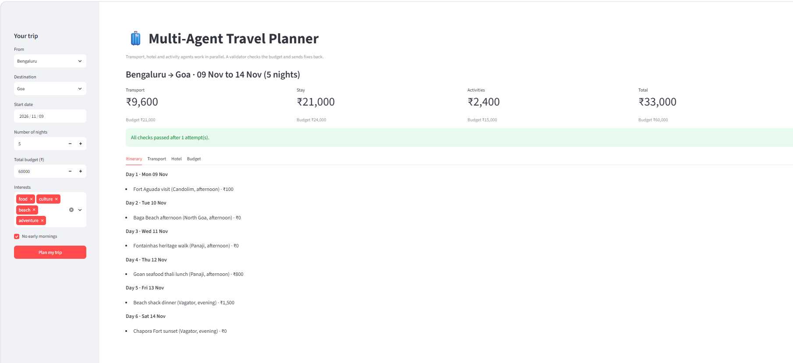
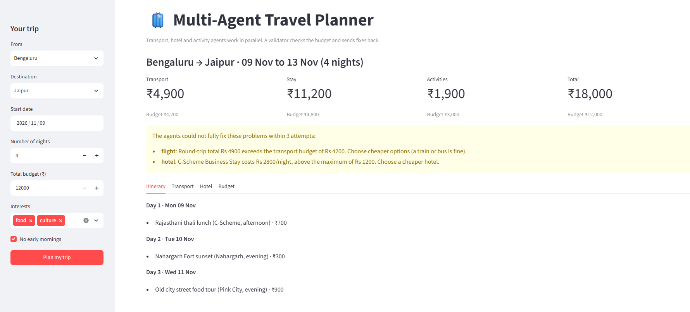
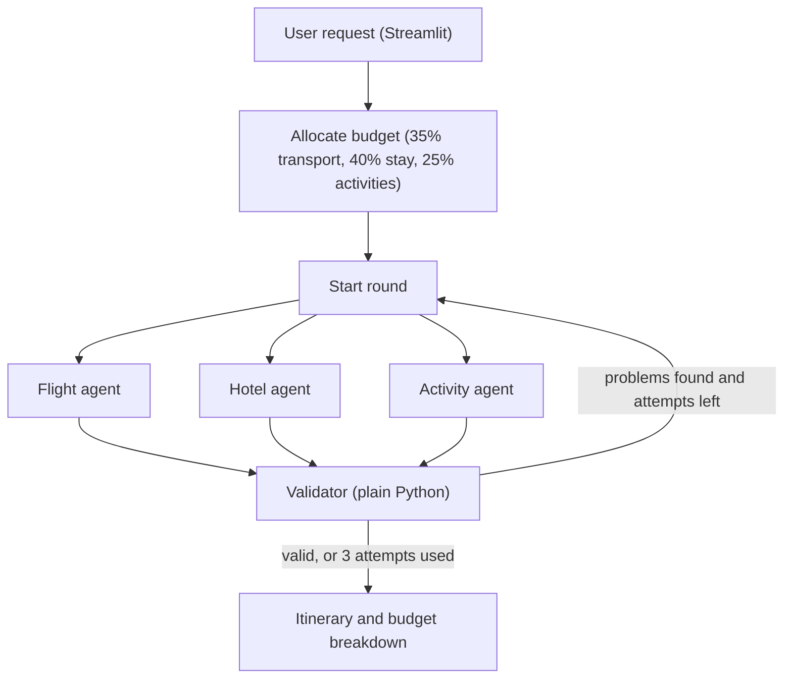

# 🧳 Multi-Agent Travel Planner

A travel planner where specialised AI agents (transport, hotel, activities) work in parallel, a validator written in plain Python checks the plan against the budget and preferences, and any failing part is sent back to the responsible agent with specific feedback until the plan is valid or the retry limit is reached.

> A learning project, inspired by [openai-agents-travel-graph](https://github.com/BjornMelin/openai-agents-travel-graph). This is a smaller, independent implementation that runs on mock data.



## Features

- **Three specialised agents**: transport (flight, train or bus), hotel and activities, each with its own tools and a typed (Pydantic) output
- **Parallel execution** of the agents with LangGraph
- **Budget allocation in code**: the budget is split across transport, stay and activities, so the LLM never does the arithmetic
- **Validator with a feedback loop**: checks budget, time-of-day preferences, activity counts and that every chosen option really exists in the data. Only the failing agent is re-run, with a precise message
- **Honest failure**: if the plan can't be fixed in 3 attempts, the app shows exactly what is still wrong
- **Streamlit web app** where the user picks destination, dates, number of nights, budget and interests

<!--  -->


## Architecture



## Tech stack

- Python 3.12, managed with [uv](https://docs.astral.sh/uv/)
- [OpenAI Agents SDK](https://github.com/openai/openai-agents-python) for the agents and tools
- [LangGraph](https://github.com/langchain-ai/langgraph) for orchestration, parallel branches and the retry loop
- Pydantic for structured agent outputs
- Gemini (Flash-Lite) through Google's OpenAI-compatible API. The provider is isolated in `travel_planner/llm.py` and can be swapped
- Streamlit for the UI

## Project structure

```
travel-planner/
├── app.py                     # Streamlit web app
├── travel_planner/
│   ├── agents/                # flight.py, hotel.py, activity.py
│   ├── orchestrator/          # graph.py, budget.py, validator.py, schedule.py
│   ├── tools/mock_data.py     # data loaders (the agents' tools)
│   ├── llm.py                 # model/provider setup
│   ├── runner.py              # async helper for Streamlit
│   ├── schemas.py             # Pydantic models
│   └── main.py                # command-line entry point
├── data/mock/                 # sample activities, hotels and transport
├── evals/                     # evaluation and benchmark scripts
└── docs/                      # screenshots
```

## Setup

1. Install [uv](https://docs.astral.sh/uv/getting-started/installation/).
2. Clone and install:

```bash
git clone https://github.com/Harshi86/travel-planner.git
cd travel-planner
uv sync
```

3. Get a free API key from [Google AI Studio](https://aistudio.google.com/apikey), copy `.env.example` to `.env` and fill it in:

```
GEMINI_API_KEY=your-key-here
GEMINI_MODEL=gemini-3.5-flash-lite
```

Free-tier limits differ per model and change over time. Check your own limits at https://aistudio.google.com/rate-limit. One trip plan makes roughly 6 to 15 model requests.

## Usage

Web app:

```bash
uv run streamlit run app.py
```

Command line (uses a fixed example trip):

```bash
uv run python -m travel_planner.main
```

## Evaluation

`evals/run_eval.py` runs 20 synthetic trip requests (including 3 with impossible budgets) and records, for each, the total cost, whether it is within budget, whether all validator rules pass, the attempts needed and the time taken. It saves progress after each case, so it can be resumed if the free API quota runs out.

```bash
uv run python -m evals.run_eval --limit 5
```

Results are written to `evals/results.csv` and `evals/summary.md`. `evals/benchmark_parallel.py` compares sequential and parallel agent execution.

<!-- After running the evaluation, paste your own numbers from evals/summary.md here, or delete this comment. -->

## Design decisions

- **Typed outputs**: agents return validated Pydantic objects, never free text, so merging and checking are reliable.
- **Plain-code validation**: arithmetic and rule checks are deterministic. LLMs are unreliable at maths and cannot be trusted to check themselves.
- **Grounding check**: the validator confirms every chosen flight, hotel and activity exists in the search results, which catches invented options.
- **Targeted retries**: only the agent that failed is re-run, with the exact reason, which saves time and API quota.

## Limitations

- All data is **mock sample data** for three destinations (Goa, Jaipur, Kochi) from Bengaluru. Prices and schedules are invented and do not match real services.
- The evaluation measures **rule compliance**, not whether an itinerary is actually good. The validator checks maximums but not minimums, so plans can be thin.
- The day scheduler is basic: it groups activities by area and time of day, and does not account for arrival and departure times.
- Free-tier model limits mean heavy use will hit quota errors.

## Roadmap

- Live data sources (places, weather, hotels) instead of mock data
- Smarter day scheduling and a minimum-quality check in the validator
- Saving past trips and preferences (SQLite)
- Caching of repeated requests
